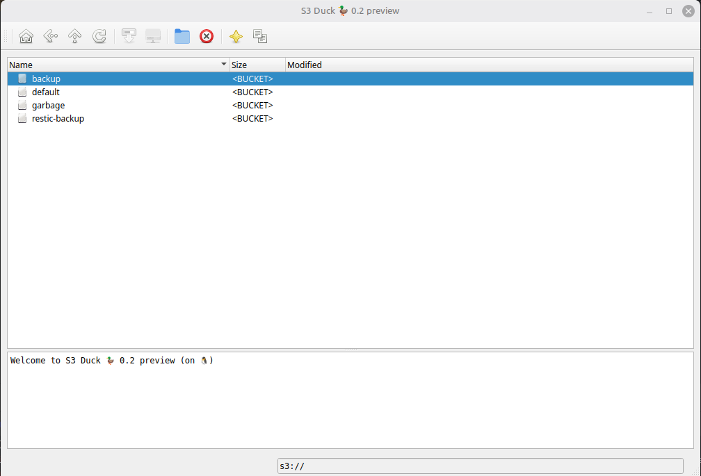
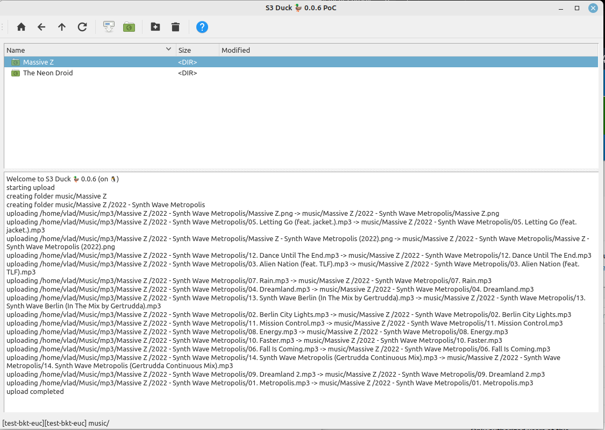

# S3Duck 🦆

Simple cross-platform GUI client for S3-compatible object storage (AWS S3, MinIO, Ceph, and others).




---

## Continuous integration

GitHub Actions (`.github/workflows/ci.yml`) runs four jobs on every push to
`main`, on every pull request, and on manual dispatch:

- **tests** — the offscreen suite on Python 3.11 and 3.12 with the PyQt6
  pinned in `requirements.txt`, plus a 3.12 leg on the newest PyQt6, boto3 and
  cryptography wheels. The same code has behaved differently on a wheel, a
  pinned older wheel and Debian's `python3-pyqt6`, so more than one Qt is
  covered on purpose.
- **icons without the Qt SVG plugin** — strips PyQt6's SVG icon engine to
  reproduce Debian/Mint's `python3-pyqt6`, then requires every icon to still
  render from its bundled PNG twin. This is the environment that produced blank
  toolbar buttons.
- **.deb package** — builds the package and checks that the build substituted
  every control placeholder, that `Installed-Size` is measured rather than
  hardcoded, that the Qt SVG/PDF dependencies are declared, and that a PNG twin
  ships for every bundled SVG.
- **end-to-end (MinIO)** — `make e2e-all`: `model.py` against a throwaway MinIO
  on the pinned SDK and on the oldest supported one, then the real window,
  headless, against the same server. Everything both suites need is a
  container, so this is the same command that runs locally.

## Features

- **Multi-profile management** — create, edit, copy, and delete named connection profiles; credentials are encrypted at rest using Fernet symmetric encryption. Each row shows its endpoint, region and pinned bucket, with colour-coded `[read-only]` / `[TLS unverified]` badges beside the name, and the list is keyboard-driven (`Enter` opens, `F2` edits, `Del` removes). Connecting runs off the UI thread behind a cancellable dialog, so an unreachable endpoint no longer freezes the launcher
- **Check profile** (launcher context menu) — proves a profile works before you open it. With no bucket set it lists buckets and with a read-only profile it lists the bucket; otherwise it writes a temporary, randomly named empty object to the bucket root and deletes it again, so it needs write and delete permission and leaves a delete marker behind on a versioned bucket
- **Profile export / import** — move profiles between machines as a bundle whose credentials are encrypted with a passphrase you choose (never written in the clear)
- **Read-only profiles** — mark a profile read-only to block every write and delete; the toolbar and context menus hide mutating actions, the title bar shows `[read-only]`, and the data layer refuses writes as a backstop
- **Temporary credentials** — session-token support for STS / SSO / assumed-role / MFA keys, with one-click import of any profile from `~/.aws/credentials`
- **Credential expiry** — a temporary key's lifetime is stored with the profile, badged in the launcher (`[expires in 12m]` / `[expired]`), counted down in the status bar, and checked before a transfer starts instead of failing half way through it
- **Credential refresh** (Tools → Refresh credentials, or the launcher's context menu) — mints a new session from the profile's `credential_process` (the AWS SDKs' own SSO / assume-role mechanism) or by re-reading the `~/.aws` profile it was imported from, without reconnecting or losing the current listing. A profile whose keys have lapsed is refreshed automatically when you open it
- **Credential storage** (launcher context menu → Credential storage…) — the key that protects saved credentials can live in the settings file (the default, and the historical behaviour), in the OS secret store via `keyring`, or sealed under a passphrase you enter once per launch; switching re-homes the same key so stored profiles stay readable
- **Icons that survive a minimal Qt** — the toolbar prefers your desktop icon theme, but falls back to bundled art whenever the theme has no entry *or* paints nothing visible; each bundled SVG has a PNG twin, so icons still appear on a Qt build without the SVG plugin (Debian/Mint's `python3-pyqt6` ships none). Run `python3 tools/icon_report.py` to see what your desktop resolves
- **Per-profile accent colour** — mark a profile with a colour; the launcher row and the open window both carry it, so prod is distinguishable from dev at a glance
- **Public base URL** — point a profile at the CloudFront distribution or custom domain in front of its bucket, and every public link and properties URL is shown against that instead of the raw endpoint. Presigned links deliberately keep the real endpoint, because their signature covers the host
- **Requester-pays buckets** — a per-profile toggle that adds `RequestPayer=requester` to every request that accepts one, without which such a bucket refuses every read
- **Diagnostics** (Tools → Diagnostics…) — Qt plugin availability, how every icon resolves, library versions and the active transfer settings, in one copyable report
- **Report a problem** (Tools → Report a problem…) — that report plus the last failure's request id and the tail of the session log, ready to copy or save. The log is also written to `~/.config/s3duck/s3duck.log` (rotated at 2 MB, switchable off in Transfer settings), because the log view is capped and dies with the window
- **Log view** — every operation is logged with a timestamp in the pane below the listing; its context menu clears it or saves what is on screen to a file
- **Open a location from anywhere** — `s3duck s3://bucket/prefix/` from a terminal, or an `s3://` link from a browser or file manager; an already-running window takes it as a new tab, while a bare launch still opens its own window. `s3duck -p NAME s3://bucket/prefix/` (or `--profile=NAME`) opens it with that profile in a new instance — it is never handed to a running window, which would open it under its own profile — and a name that matches no profile is refused with a message rather than falling back to another one. `s3duck --help` prints the usage
- **Quick open** (`Ctrl+P`) — type-to-jump across buckets and bookmarks, using the command palette's matcher
- **Sync to another profile** — compare this prefix against one in a different account or provider, review the dry-run plan, then run it; the bytes stream through this machine because no server-side copy can span two credentials
- **Command palette** (`Ctrl+K`) — type-to-run index of every toolbar and menu action, built from the live actions so it cannot drift (context-menu entries are built on demand when the menu opens, so they are not in it)
- **Copy to another profile** — stream objects (or whole prefixes) into a different account or provider; a server-side copy cannot use two sets of credentials, so the bytes travel through this machine
- **Bucket browser** — list, create, and delete buckets; recursive delete runs through the transfer queue (progress + cancel, UI stays responsive)
- **Empty bucket** — delete every object, version, delete marker and in-flight upload while keeping the bucket, queued with progress and cancel
- **Incomplete uploads** — find and abort in-flight multipart uploads that are invisible to normal listings but keep their parts billed; shows how much space they waste and can abort everything older than N days
- **Object browser** — navigate prefixes as a virtual folder tree with sorting by name, size, and modified date; optional Storage-class and ETag columns via the header context menu (both come free with the listing)
- **Upload** — single/multiple files via dialog or drag-and-drop from the OS file manager; whole directory trees via "Upload folder" (`Ctrl+Shift+U`) or drag-and-drop
- **Download** — single files or entire folder prefixes, recreating the directory tree locally
- **Download as ZIP** — stream a selection (files and whole folders) straight into one archive, without staging it on disk twice
- **Drag out** — drag objects from the list onto a file manager; the selection is downloaded to a temp folder first, with progress and a size warning. Staged payloads are removed when the app exits, and a crashed run's leftovers are reclaimed on the next start
- **Resumable uploads** — a large upload is sent part by part with its upload id recorded, so an interrupted transfer resumes instead of restarting; a cancelled one deliberately leaves the parts on the server (clean them up from Incomplete uploads)
- **Resumable downloads** — large files download as parallel ranges into a `.s3duckpart` file with a progress sidecar, so an interrupted transfer picks up where it stopped instead of restarting (a changed ETag discards the stale partial). This applies to every download route — a single file, a whole folder, a sync, a drag-out — because they all go through one per-object path rather than each deciding for itself
- **Upload rules by destination** — `archive/* -> class=GLACIER, tag:team=infra`: a small app-wide table (one set of rules shared by every profile, edited in Transfer settings) that decides the storage class and tags from the key an upload is heading for, so a storage policy is applied rather than remembered
- **Content-Type detection** — every upload is stamped with a type derived from the file extension, so a public link renders in a browser instead of downloading as `binary/octet-stream`; the table is overridable per extension, and the object context menu's "Fix Content-Type from extension" re-stamps objects that were uploaded before (or by something else)
- **Additional checksums** — upload with CRC32/SHA1/SHA256, plus CRC32C and CRC64NVME (AWS's own current default) where `awscrt` is installed. Every CRC is requested as a whole-object checksum, so multipart objects stay verifiable unlike a multipart ETag — where the installed boto3 is old enough not to know `ChecksumType`, the upload drops to a per-part composite rather than failing. The list is built from what this machine can *recompute*, not from what S3 accepts: an algorithm we could send but not reproduce would make every verified download a verification that never happened, so the two halves appear and disappear together (Tools → Diagnostics…, which names the ones available here)
- **Checksum verification** — optionally compare each downloaded file against the object's stored digest and fail the transfer on a mismatch, for every file of a whole-folder download as much as for a single object. A multipart object is settled by asking the service for its real part boundaries (`GetObjectAttributes`) and rebuilding the composite digest from them, so "multipart, not comparable" is now the exception rather than the rule; where a backend does not implement that call, verification still degrades to reporting the object as not comparable rather than failing it (the end-to-end suite calls it against MinIO and prints how many parts came back, but passes either way)
- **Parallel transfers** — configurable number of files moving at once *and* multipart connections within each file; applies to uploads, downloads (including whole prefixes) and sync
- **Transfer settings** — files in flight, connections per file, bandwidth limit, multipart part size and threshold, resumable uploads, automatic retry of transient failures, the per-listing entry limit, the session log file, Content-Type detection with its override table, the upload rules by destination, download verification, completion notifications, plus the storage class, checksum and server-side encryption (SSE-S3 / SSE-KMS) applied to uploads — all persisted across sessions and shared by every profile
- **Overwrite protection** — uploads (dialog, folder upload, drag-in and the dual pane's `F5`), downloads (single files *and* whole folders), copies, moves, renames and pastes all detect existing destinations and offer Skip / Overwrite / Cancel. For uploads the answer is then *enforced by the service*: unless you chose Overwrite, every write carries an `If-None-Match` precondition, so an object that appears after the check — the gap a check-then-write always leaves — is refused and reported as skipped instead of being replaced. A backend without conditional writes — or an installed boto3 too old to send the header, which is what a distribution package often pins — degrades to the old check-then-write and says so in the log. The answer travels with the job, so a retry — an automatic one included — and a re-run from history keep it instead of overwriting on the second attempt
- **Sync with a local folder** (`Ctrl+E`) — compare a directory against a prefix in either direction, review a dry-run plan (upload / download / delete / skip with a reason per file), then run it through the queue; supports exclude globs (`*.tmp`, `node_modules/`) and optionally deleting extras at the destination
- **Transfer queue** — queued jobs with per-row progress, cancel, and retry for failed or cancelled entries; "Retry failed" re-queues every failure at once, and a job the service itself asked us to repeat (throttling, 5xx, a dropped connection) is retried once automatically. A retry runs in the bucket and profile the job was made in, not whichever one is open by then
- **Transfer history** — a persisted log of past jobs (when, what, bytes, outcome) with one-click re-run for small jobs, from the queue panel. A re-run goes to the bucket the job ran in and is refused under another profile; a sync is never replayed, because its plan was worked out from both sides as they were then — open Sync again for a fresh comparison
- **Bandwidth limit** — optional ceiling on total transfer throughput, shared across every parallel file and chunk
- **Completion notifications** — a desktop notification when the queue drains while the window is in the background (toggle in Transfer settings)
- **Delete** — objects and folder prefixes (recursive, batched 1000 keys per call, and cancellable inside the walk rather than only between selected rows); confirmation shows the scanned object count and total size; recursive bucket delete also purges noncurrent versions, delete markers and in-flight uploads
- **Undo delete** (`Ctrl+Z`) — on a versioning-enabled bucket a delete only writes a delete marker, so the last delete can be rolled back by removing the markers *that delete* wrote — anything deleted from the same folder earlier stays deleted. A delete made while versioning was suspended removed the object outright and is reported as not restorable
- **Clipboard** (`Ctrl+C` / `Ctrl+X` / `Ctrl+V`) — copy or cut a selection and paste it into any folder or bucket; copying also puts the `s3://` URIs on the system clipboard for use elsewhere
- **Copy / Move** — server-side copy or move of a multi-selection, within a bucket or **across buckets**; when the destination lives in another region or account (where a server-side copy is impossible) the object is streamed through instead of failing. Copies, moves, renames and pastes keep each object in its **own storage class** — a plain `CopyObject` carries none and S3 would create the new object as STANDARD, re-tiering an IA or Glacier-IR object nobody asked to re-tier. The class comes from the listing, which already knows it, so nothing is spent discovering it; only a route with no listing behind it — an object picked in the other pane, a pane comparison, a job replayed from an older history entry — costs one `HeadObject`. It holds on all three routes — the single copy, the multipart rebuild past 5 GiB, and the cross-region stream — and metadata, content type and cache headers ride along as they always did. A backend that names a class in its own listing and then refuses it on a copy (`InvalidStorageClass`, `NotImplemented`) gets the plain copy it used to get, and the log says the class was not preserved: the tier is worth one request, never the copy itself. A source that is archived in GLACIER or DEEP_ARCHIVE and **not restored** cannot be copied at all: the service refuses to read it, and the failure now says so and points at Restore from Glacier instead of reporting `InvalidObjectState`
- **Objects over 5 GiB** — S3 refuses a `CopyObject` whose source is larger than that, which used to be a hard failure for every copy onto itself: rename, bulk rename, paste, change storage class, edit metadata and "Fix Content-Type". Such an object is now rebuilt at the destination from `UploadPartCopy` ranges, which the service still performs itself — not the streaming fallback, and no part of it travels through this machine. Where the listing already knows the size, the doomed single copy is skipped rather than bought with a request
- **Rename** — in-place rename of a file or folder (server-side copy + delete), on the context menu or `F2`
- **Bulk rename** (`Shift+F2`) — rename a whole selection by find-and-replace (optionally regex, with backreferences) or a `{name}/{ext}/{n}` numbering template, with a live preview and duplicate/invalid-name checks. A plan in which a new name is another selected item's current name (renumbering 1,2,3 to 2,3,4, or a swap) is refused: a rename is copy-then-delete, so it would overwrite objects before moving them — rename via temporary names instead
- **Create folder** — creates an S3 prefix placeholder
- **Preview / open** — double-click a file to preview images, text, **PDFs** and syntax-highlighted code in-app, with a **hex dump** for binaries; anything can still be opened with the OS default application
- **Edit in place** — a text object that arrived whole can be edited in the preview and written back with an `If-Match` precondition, so a concurrent save is refused rather than silently overwritten (backends without conditional writes — and an installed boto3 too old to send `If-Match` on a PUT — fall back to an ETag check). The save keeps the object's Content-Type, Cache-Control and other headers, user metadata, storage class, encryption and tags. Text the editor cannot hand back byte-for-byte — CR or CRLF line endings, a byte-order mark, non-breaking spaces — is shown read-only, since saving would rewrite them throughout the file
- **Recursive search** — search a whole bucket/prefix by key substring or regular expression (`Ctrl+Shift+F` or "Search here…"), filtered by size range, extension and modified date, with jump-to-location on any result
- **Act on search results** — select any number of matches and download, delete, tag, re-type, restore or change the storage class of all of them through the transfer queue, or copy their keys and `s3://` URIs
- **Saved searches** — name a query with its filters and re-run it from a drop-down; stored per profile, so a recurring cleanup is one click rather than a re-typed form
- **Object versioning** — enable/suspend bucket versioning from the UI; list every version and delete marker of an object, download a specific version, promote an older version to current, or delete individual versions
- **Diff two versions** — select any two versions of a text object and see a coloured unified diff of what changed, which is the question a version list is usually opened with
- **Storage class** — view an object's storage class and change it (Standard, IA, Intelligent-Tiering, Glacier, Deep Archive, …); works on a multi-selection or whole folders and runs through the transfer queue
- **Glacier restore** — initiate a restore of archived objects (single, multi-select, or whole prefixes) with a chosen retrieval tier and retention window, queued like other transfers; restore status shown in properties
- **Bulk tagging** — add, overwrite or strip tags across a whole selection, expanding folders to every object beneath them
- **Edit metadata** — set `Content-Type`, `Cache-Control`, `Content-Disposition`, `Content-Encoding`, and custom `x-amz-meta-*` user metadata
- **Object properties** — key, size, ETag, storage class, restore status, Object Lock retention and legal hold (probed in the background, since most buckets have none), and public URL
- **Legal hold** — the object context menu's Legal hold… entry places or clears an Object Lock legal hold on one object after reading its current state; while it is on the object cannot be deleted or overwritten. A bucket without Object Lock says so instead (it can only be enabled when the bucket is created)
- **Presigned links** — generate a temporary download (GET) or **upload (PUT)** link with a configurable expiry (up to the 7-day S3 maximum)
- **Make public** — set `public-read` ACL and copy direct URL; when the ACL is refused, Block Public Access and Object Ownership settings are reported as the reason
- **Location tabs** (`Ctrl+T`) — keep several buckets/prefixes a click apart in one window, reorder them by dragging, and reopen them next time; `Ctrl+W` closes one, `Ctrl+Tab` cycles. They are remembered locations for one shared listing view, not independent views, so switching tabs navigates
- **Compare panes** (Tools → Compare panes…) — what differs between the two panes, recursively: only-here, only-there, differs, identical, with the selected differences copyable either way. This is also how two prefixes in one account get compared, which previously had to go through a local folder. Files of the same size are judged on content rather than timestamps — ETags against each other, or a local file's MD5 (or rebuilt multipart ETag, up to 512 MiB) against the remote one — so a folder compared with its own upload, or a prefix with its server-side copy, shows as identical. A pair whose content cannot be compared (an encrypted object's ETag, a multipart one at an unknown part size) is shown as "same size, different time" and is not hidden as identical
- **Dual pane** (`F3`) — a second pane showing a local folder or another remote prefix, with `F5` to copy the focused pane's selection to the other side and `F6` to move it, all through the transfer queue. `F5` belongs to Refresh while there is only one pane, and Refresh keeps `Ctrl+R` either way
- **Watch a folder** (Tools → Watch folder…) — mirror a local folder up to a prefix on an interval; each pass compares the two and queues only what differs, and a pass is skipped while the queue is still busy. A pass whose local folder is missing or unreadable is skipped and flagged rather than read as empty; with "Delete objects that no longer exist locally" on, so is a pass whose folder is empty while the prefix is not — the signature of an unmounted drive — instead of deleting the remote side. The settings are remembered, but a watch is never resumed on its own at startup
- **Back / forward** (`Alt+←` / `Alt+→`) — a real navigation trail per tab, across buckets, that a new move truncates the way a browser does
- **Clickable breadcrumb** — jump straight to any parent prefix, the bucket root, or the bucket list from the path bar
- **Go to location** (`Ctrl+L`) — paste an `s3://bucket/prefix` (or a bare prefix) and jump straight there, across buckets
- **Restore last location** — each profile reopens the bucket and prefix you left it in, and the launcher preselects the profile you used last
- **Bookmarks** (`Ctrl+B`) — save any bucket/prefix and return to it from the toolbar menu, with rename/remove management; stored per profile
- **Quick filter** (`Ctrl+F`, or just start typing in the listing) — narrow it by name, or use a glob (`*.log`, `2026-0?-*`); the bar shows how many of the rows match, so an over-narrow filter is not mistaken for an empty folder
- **Large prefixes** — a listing reports its running count while it loads and stops at a configurable limit, saying so rather than silently showing the first N of a much bigger prefix
- **Remembered layout** — splitter position, column widths and sort order persist between sessions
- **Listing summary** — folder/file counts and total size of the current listing in the status bar
- **Keyboard shortcuts** (`Ctrl+/`) — a reference table built from the window's QActions plus a hand-kept list of the keys that have no QAction (`core/commands.py`), since plain letters are reserved for type-to-search. Besides the ones named above: `Ctrl+D` download, `Ctrl+U` upload, `Ctrl+N` or `Insert` create a bucket or folder, `Del` delete, `Ctrl+S` bucket usage, `Ctrl+Q` show or hide the transfer queue, `Alt+↑` or `Backspace` up one level, `Alt+Home` or `Home` back to the bucket list, `Ctrl+Shift+Tab` previous tab, `Esc` clears the quick filter (a second press cancels transfers), and `F1` in the listing opens About
- **Theme** — Light, Dark, or system-default appearance, remembered across sessions
- **Duplicate finder** (Tools → Find duplicates, `Ctrl+Shift+D`) — group objects holding identical content by size + ETag at the cost of a listing, showing reclaimable space; select all-but-newest/oldest and delete the redundant copies. Objects whose ETags cannot settle the question (multipart vs single-part) are listed separately and never auto-selected — "Confirm candidates" then settles them from each object's stored digests, without downloading either copy, where the backend can supply one
- **Bucket usage stats** — total size and object count, breakdown by file category with a pie chart, top folder groups, a storage-class breakdown and the largest objects
- **Size explorer** (Tools → Size explorer…) — a treemap of the bucket by prefix, drilling down on a click. Area is the only encoding that makes a 400 GB folder look like one, which a breakdown by file category cannot
- **Integrity manifest** (Tools → Export manifest…, then Tools → Verify against manifest…) — record what a prefix holds as a CSV, then later ask what has gone missing, been added, or changed. Both directions cost one listing, so it is affordable on a bucket you would never hash
- **Cost estimate** — on an AWS endpoint the usage report also prices the storage per class and shows what the STANDARD bytes would cost in IA, Glacier IR or Deep Archive, with the minimum-duration catch spelled out beside each one (storage only, us-east-1 list price)
- **Bucket settings** (Tools → Bucket settings…) — lifecycle rules with a real editor (transitions, expiration, noncurrent versions, aborting incomplete uploads), the CORS document, the bucket policy (read-only until you tick "Allow editing", and JSON-checked before it is sent), default encryption, the bucket's own tags, static-website hosting, transfer acceleration, a read-only view of the event notifications, and Object Lock state — all read in one background pass. A rule filtered by tag or object size is listed and summarized but not editable here, because rebuilding it from the prefix form would silently widen it
- **Runtime profile switch** — switch S3 accounts without restarting the app
- **Cached bucket bindings** — the proven endpoint/region/addressing combination per bucket is remembered, so reopening an off-region bucket skips the probe round trips
- **Automatic region/endpoint detection** — when an operation fails due to a region or endpoint mismatch the app probes the server for the correct region, rebuilds the client, and retries transparently; applies to bucket open, listing, upload, download, and delete
- **HTTP proxy and private CAs** — a per-profile proxy, and a CA bundle to trust so a corporate MITM certificate or a self-signed MinIO one can be verified by path instead of switching verification off entirely; a bundle that is not there is reported before it becomes an opaque SSL error
- **Failure details** — a failed transfer keeps the error code, HTTP status, request id and host id the service returned, shown behind the row's ℹ button and copyable in one click. `str(exception)` alone can never be traced back to a request on the provider's side
- **S3-compatible storage** — path-style addressing option for MinIO and similar backends
- **Cross-platform** — Linux, macOS, Windows

Planned work and known limitations are tracked in [ROADMAP.md](ROADMAP.md).

---

## Testing

`make` lists every target; `make check` runs all three suites.

Three suites. The unit suite stubs every S3 call: it needs the
`requirements.txt` packages (PyQt6, boto3, cryptography) but no server, no
network and no Docker:

```
make test
```

which is `python -m unittest discover -s tests -t .` — the `-t .` is
load-bearing, see `tests/__init__.py` for why.

The end-to-end suite drives `model.py` against a **real** S3 server, because
every claim this project makes about how a server behaves is otherwise
unverified. It brings up a throwaway MinIO in Docker (Docker with the Compose
v2 plugin, `docker compose`, is the only requirement), runs, and removes
everything it created:

```
make e2e
```

It skips itself when no endpoint is configured, so the command above is the
only way it costs anything — a plain `unittest discover` stays offline and
green. To run it against a server you already have instead:

```
S3DUCK_TEST_ENDPOINT=http://localhost:9000 \
S3DUCK_TEST_ACCESS_KEY=... S3DUCK_TEST_SECRET_KEY=... \
    python -m unittest discover -s tests/e2e -t .
```

`S3DUCK_TEST_REGION` sets the signing region (default `us-east-1`); the keys
default to `minioadmin`. Under `make e2e`, `S3DUCK_TEST_RUNNERS=runner` or
`S3DUCK_TEST_RUNNERS=runner-old` narrows the model suite to the pinned or the
oldest supported boto3 (`./run_e2e.sh` documents its selectors).

The third suite drives the **real GUI** against the same throwaway MinIO, on
Qt's offscreen platform — no display, no window manager, real widgets:

```
make e2e-gui        # or: make e2e-all, for this and the model suite
```

It exists because the other two meet nowhere. The unit suite builds a real
`MainWindow` but answers it with `FakeS3Client`; the model suite asks a real
server but never involves Qt. Everything in between — the navigation worker,
the transfer queue, the per-worker model clones, the queued signals that carry
a result back onto the UI thread — was only ever exercised against a fake, and
a background thread meeting a real network is where this kind of application
breaks. These tests call the methods the menus call, pump the Qt event loop
until the real workers finish, and then ask the bucket, through a separate
boto3 client, what actually happened.

The only things stubbed are `QFileDialog` and `QMessageBox`: those are the
operating system asking the user something, and headless there is nobody to
answer. Any *other* modal that opens fails the test by name rather than
hanging it, which is what keeps an unanswerable dialog from turning into a
silent timeout.

MinIO archived its open-source server in 2025 — `quay.io/minio/minio` stopped
granting anonymous pulls, the Docker Hub repository went away, and `dl.min.io`
answers `410 Gone` for every community binary — so the compose file names the
Alpine project's rebuild of the final community release, pinned to that exact
upstream tag. It stays on MinIO rather than moving to another server because
half the limitations documented here are statements about how MinIO behaves,
and a different backend would answer differently and quietly stop checking
them. `S3DUCK_TEST_MINIO_IMAGE` overrides the image if you host your own.

The model suite's runner image holds boto3 and nothing else: `model.py`
imports no Qt, so it needs no display and no PyQt6. The GUI runner is the one
that pays for PyQt6, which is why they are separate images. Alongside the
round trips, the model suite records what the backend under test actually
implements — `GetObjectAttributes`, conditional writes, ACLs, restore, Object
Lock. Most of those probes accept either answer and print which one they got
(what they assert is that the app's fallback holds), so a documented
limitation that stops being true shows up in the suite's output rather than as
a failure.

What the model suite covers, a module at a time (`tests/e2e/`):

| Module | What only a server can settle |
|---|---|
| `test_roundtrip.py` | Listings, uploads, downloads, server-side copy, prefix delete |
| `test_capabilities.py` | Multipart, checksums, conditional writes, presigned URLs, and which optional features this backend has |
| `test_corner_cases.py` | Awkward keys, zero-byte and threshold-sized objects, local filesystem limits, storage classes |
| `test_regressions.py` | The premises past fixes rest on: a `..` in a key, `DeleteObjects` refusing keys in a 200 |
| `test_bucket_admin.py` | *Writing* lifecycle rules, policies and tags — and that CORS, website hosting and encryption are refused with something the dialog can show |
| `test_object_lock.py` | Legal holds: that the server refuses the delete, and that a held version survives the delete marker written over it |
| `test_versions.py` | Fetching one version, promoting an old one, deleting a single version, delete markers |
| `test_cross_profile.py` | Copying between two independent clients, and a read-only destination refusing before anything is written |
| `test_discovery.py` | Deep search filters, the sync planner's tree, duplicate fingerprints, usage totals across pages, preview windows |
| `test_profile_and_sdk.py` | The profile check's write-and-remove probe, and which parameters the *installed* SDK will actually send |
| `test_transfer_tuning.py` | The transfer settings as requests: files in flight, threads per file, the bandwidth ceiling, part sizes |
| `test_upload_policy.py` | What an upload carries besides the body — the per-destination rules' storage class and tags, as the service stores them |

And the GUI suite (`tests/e2e_gui/`), which asks the same server what the
window actually did:

| Module | What only the real window can settle |
|---|---|
| `test_navigation.py` | Prefix listings through the navigation worker, sibling prefixes, a refresh seeing a change made behind the app, a failed navigation re-enabling the list view |
| `test_transfers.py` | Uploads, downloads and deletes driven through the window's own entry points, and the transfer queue draining them |
| `test_queue_outcomes.py` | How a job *ends*: done, cancelled or failed, and whether the user is told — the dialog as much as the row; and a read-only window refusing uploads and deletes while reads and downloads still work |

## Requirements

| Dependency    | Version                    | Purpose                          |
|---------------|----------------------------|----------------------------------|
| Python        | ≥ 3.10                     | Runtime                          |
| PyQt6         | 6.7.0 pinned               | GUI framework                    |
| boto3         | ≥ 1.26.76 (1.42.44 pinned) | AWS / S3-compatible SDK          |
| cryptography  | 46.0.4 pinned              | Fernet credential encryption     |
| keyring       | optional                   | Keep the credential key in the OS secret store |
| awscrt        | optional                   | CRC32C and CRC64NVME upload checksums          |
| pyinstaller   | 6.18.0 pinned              | Binary packaging — installed by `requirements.txt`, used only by the build targets |

*Pinned* is the version in `requirements.txt`, which CI and the end-to-end
images run; CI also runs the newest PyQt6, boto3 and cryptography wheels. The
.deb takes the distribution's `python3-pyqt6`, `python3-boto3` and
`python3-cryptography` with no minimum version. boto3 is exercised back to
1.26.76 by the end-to-end suite's old-SDK leg: an SDK too old to send
`IfNoneMatch`, `IfMatch` or `ChecksumType` gets the documented fallbacks
rather than a failed transfer.

---

## Running from Source

**Quick start (system packages, Debian/Ubuntu):**
```bash
sudo apt install python3-boto3 python3-cryptography python3-pyqt6 \
                 python3-pyqt6.qtsvg python3-pyqt6.qtpdf
sudo apt install python3-keyring python3-awscrt    # optional
python3 s3duck.py
```

`python3-pyqt6.qtsvg` draws the bundled SVG icons (without it they fall back
to their PNG twins) and `python3-pyqt6.qtpdf` is the PDF preview; the .deb
depends on both. `keyring` lets the credential key live in the OS secret store
and `awscrt` adds the CRC32C / CRC64NVME checksums.

**Recommended — virtualenv:**
```bash
python3 -m venv .venv            # or: make venv
source .venv/bin/activate
pip install -r requirements.txt
pip install keyring awscrt       # optional, see above
python3 s3duck.py                # or: make run
```

The PyQt6 wheel bundles QtSvg and QtPdf, so nothing else is needed there.

---

## Building

`make` on its own lists every target. Each one delegates to the script below
it, so the two never disagree about how something is built; the version is
read from `__VERSION__` in `version.py` rather than repeated anywhere.

```bash
make deb          # this machine's architecture
make debs         # amd64 + arm64
make bin          # self-contained Linux binary
make clean        # build/, dist/, caches, PyInstaller leftovers
```

### Debian / Ubuntu package
```bash
make deb                    # or: bash build_deb.sh
make deb-arm64              # explicit architecture (or: bash build_deb.sh arm64)
```
The only tool it needs is `dpkg-deb`, which every Debian/Ubuntu system has
(it is part of `dpkg`); the script stops if it is missing. Run the scripts
with `bash` rather than `./`: their `#!/bin/env bash` shebang only resolves on
a usr-merged filesystem. Output: `build/s3duck_<version>_<arch>.deb`,
checkable with `make check-deb`

### Linux binary (PyInstaller)
```bash
make bin                    # or, with the venv active: bash build_linux_bin.sh
```
`make bin` puts `.venv/bin` on PATH first, because `requirements.txt`
installs PyInstaller into the venv rather than onto the system PATH.

### macOS binary + DMG
```bash
make macos                            # native arch
make macos ARCH=universal2            # fat binary (x86_64 + arm64)
make dmg
```
`make macos` leaves `dist/s3duck.app`; `make dmg` packs it into
`dist/S3Duck.dmg` and needs `create-dmg` (`brew install create-dmg`).

### Windows binary
```bat
build_win.cmd
```
Run it from a prompt where `pyinstaller` is on PATH (the activated venv).

Pre-built releases are available on the [GitHub releases page](https://github.com/nexusriot/s3duck/releases/latest).

---

## Project Architecture

```
s3duck/
├── s3duck               Shell launcher installed as /usr/bin/s3duck by the .deb
├── s3duck.py            Entry point — QApplication bootstrap, command line,
│                        Profiles dialog
├── main_window.py       MainWindow itself — assembly, actions, the operations
│                        that are not any one mixin's
├── model.py             The S3 front door — a facade over the s3/ mixins
├── settings.py          Profile create/edit dialog
├── properties_window.py Object properties dialog
├── profile_switcher.py  Runtime profile-switch dialog
├── theme.py             Light / Dark / system palette switching
├── settings_store.py    Typed QSettings access — groups, coercions, per-profile keys
├── version.py           The app version — read by the Makefile and build_deb.sh
│
├── core/                Pure domain logic — no Qt, no boto3 import, no client
│                        of its own (parts._multipart_upload_size is the one
│                        helper that is handed one)
│   ├── naming.py        File categories, human sizes, epoch coercion
│   ├── errors.py        The failures the S3 layer raises by name
│   ├── checksums.py     Block-at-a-time digest primitives
│   ├── integrity.py     ETags, checksums, fingerprint comparison
│   ├── parts.py         Multipart and server-side-copy part sizing
│   ├── endpoints.py     Endpoint URL reading, region swap, redirect conflicts
│   ├── objects.py       Restore state, tag merging, delete results
│   ├── search.py        Search form → one predicate over listing rows
│   ├── pricing.py       Storage cost estimate, colder-class options
│   ├── lifecycle.py     Lifecycle rule read / summarise / build
│   ├── upload_rules.py  Per-pattern upload settings, content-type overrides
│   ├── sync_plan.py     Tree comparison and the plan it produces
│   ├── manifest.py      Manifest write, parse and verify
│   ├── dedup.py         Duplicate grouping and redundant-key selection
│   ├── bulk_rename.py   Bulk rename planning
│   ├── bookmarks.py     Saved places and their storage form
│   ├── locations.py     bucket/prefix strings, quick-open rows
│   ├── commands.py      Command palette ranking, shortcut sheet rows
│   ├── transfer_jobs.py Drag/paste → transfer rows
│   ├── treemap.py       Squarified treemap layout and prefix tree
│   ├── formatting.py    Number and byte rendering
│   ├── entries.py       Item, FSObjectType, PrefixDownloadPlan
│   └── profile.py       ProfileSettings — one connection, by name not position
│
├── s3/                  The boto3 layer — Model's mixins
│   ├── common.py        What the pieces share: checksum table, progress, limiter
│   ├── binding.py       Client, addressing style, region probing and re-binding
│   ├── listing.py       Reading a bucket or a prefix
│   ├── upload.py        Multipart, resume, and the rules that shape a PUT
│   ├── download.py      Getting bytes out, and proving they arrived intact
│   ├── copy.py          Server-side copy and the stream-through fallback
│   ├── delete.py        Objects, versions, prefixes and whole buckets
│   ├── bucket_admin.py  Policy, CORS, lifecycle, encryption, locking
│   └── object_admin.py  Metadata, tags, class, versions, integrity
│
├── workers/             QObjects that run on a QThread, talking by signal only
│   ├── navigation.py    NavigationWorker, BucketEnterWorker
│   ├── transfer.py      Worker — upload, download, copy, move, sync, zip, tags
│   └── usage.py         UsageWorker — bucket size by category and class
│
├── ui/                  The Qt layer
│   ├── constants.py     Values the window and its dialogs both rely on
│   ├── context_menu.py  The listing's right-click menu, entry + handler as one
│   ├── window/          MainWindow's mixins — one per cluster of its state
│   │                    navigation, history, tabs, transfers, quickfind,
│   │                    bookmarks, watch, usage, credentials
│   ├── widgets/         Listing view, charts, breadcrumb, second pane, queue
│   │                    panel, profile picker, highlighters, click guard
│   └── dialogs/         Dialogs grouped by area (18 modules, 30 dialogs)
├── diagnostics.py       Qt plugin / icon / library report (Tools → Diagnostics)
├── utils.py             Shared helpers — Crypto and CredentialStore, Qt thread
│                        plumbing, ~/.aws parsing, credential expiry, local tree scan
│
├── icons/               24 px toolbar and menu icons — every SVG with a PNG
│                        twin, for Qt builds that ship no SVG plugin
├── resources/           App icon (ico/icns/png), screenshots, .desktop file
├── DEBIAN/              Debian package metadata (control, postinst, prerm)
├── tests/               Three suites: offscreen unit, model e2e, GUI e2e
│   ├── support.py       Shared fakes, stubs and helpers
│   ├── unit/            One module per area, mirroring the tree above
│   ├── e2e/             Model end-to-end suite + its MinIO compose harness
│   └── e2e_gui/         GUI end-to-end suite: the real window, headless
├── tools/               CI helpers and the icon report
│
├── Makefile             Front door: make test / e2e / e2e-gui / deb / bin / clean
├── requirements.txt     Python dependencies
├── run_e2e.sh           End-to-end suites against a throwaway MinIO
├── build_deb.sh         Build .deb package
├── build_linux_bin.sh   Build Linux self-contained binary
├── build_macos_bin.sh   Build macOS self-contained binary
├── build_dmg.sh         Pack macOS binary into .dmg
└── build_win.cmd        Build Windows self-contained binary
```

### Layers

```
┌─────────────────────────────────────────────────────────────────┐
│  Entry / Profile layer   s3duck.py                              │
│  Profiles dialog, SettingsItem, credential refresh              │
├─────────────────────────────────────────────────────────────────┤
│  Credential layer        utils.py                               │
│  Crypto (Fernet), CredentialStore (settings / keyring /         │
│  passphrase), credential_process, expiry_state                  │
├─────────────────────────────────────────────────────────────────┤
│  UI layer                main_window.py + ui/window/            │
│  MainWindow, assembled from one mixin per cluster of its state: │
│  navigation, history, tabs, transfers, quickfind, bookmarks,    │
│  watch, usage, credentials                                      │
├─────────────────────────────────────────────────────────────────┤
│  Widget layer            ui/widgets/                            │
│  Tree, UpTopProxyModel, SecondPane, PieWidget, TreemapWidget,   │
│  Breadcrumb, TransferQueuePanel, ProfilePicker                  │
├─────────────────────────────────────────────────────────────────┤
│  Dialog layer            ui/dialogs/                            │
│  One module per feature — bucket settings, preview, versions,   │
│  search, duplicates, compare, sync … plus SettingsWindow,       │
│  PropertiesWindow and ProfileSwitchWindow at the top level      │
├─────────────────────────────────────────────────────────────────┤
│  Worker / Threading layer   workers/                            │
│  NavigationWorker  BucketEnterWorker  Worker  UsageWorker       │
│  (each runs in a QThread, communicates via pyqtSignal)          │
├─────────────────────────────────────────────────────────────────┤
│  Data / S3 layer         model.py + s3/                         │
│  Model — a facade; binding, listing, upload, download, copy,    │
│  delete, bucket_admin and object_admin are its mixins           │
├─────────────────────────────────────────────────────────────────┤
│  Domain layer            core/                                  │
│  Planning, parsing, comparison and pricing. No Qt, no boto3     │
│  import — testable without a QApplication or a client, and      │
│  guarded as such by CorePurityTests. One helper,                │
│  parts._multipart_upload_size, is handed a client to page.      │
└─────────────────────────────────────────────────────────────────┘
```

### Key components

| Component | File | Responsibility |
|---|---|---|
| `Profiles` | s3duck.py | CRUD for connection profiles; launches MainWindow |
| `Crypto` | utils.py | Fernet encrypt/decrypt of stored credentials |
| `CredentialStore` | utils.py | Where the credential key lives — settings file, OS secret store, or sealed under a passphrase |
| `run_credential_process` | utils.py | Mints a session from a profile's `credential_process`, the AWS SDKs' own SSO / assume-role refresh |
| `MainWindow` | main_window.py | Root window — toolbar, splitter (tree + log), statusbar |
| `Tree` | ui/widgets/listing.py | Drag-and-drop `QTreeView`; hands drops to upload worker |
| `UpTopProxyModel` | ui/widgets/listing.py | Proxy that pins `[..]` to top and sorts BUCKET < FOLDER < FILE |
| `NavigationWorker` | workers/navigation.py | Off-thread bucket/prefix listing; uses a private `Model` clone to avoid client races |
| `BucketEnterWorker` | workers/navigation.py | Off-thread bucket entry with hints-based region/endpoint retry |
| `Worker` | workers/transfer.py | Off-thread upload / download / delete with byte-level progress and cancellation |
| `UsageWorker` | workers/usage.py | Off-thread bucket size aggregation by file category, storage class and estimated cost |
| `SecondPane` | ui/widgets/second_pane.py | The other half of the dual pane — a local folder or a remote prefix, listing only |
| `PieWidget` | ui/widgets/charts.py | Custom `QPainter` pie chart for usage breakdown |
| `Model` | model.py + s3/ | The one front door to boto3. The class itself keeps only construction, the read-only write guard, the three throughput setters and `get_os_family`; every call that touches a bucket lives in an s3/ mixin — `binding.py` probes addressing styles and auto-corrects region mid-session, `object_admin.py` supplies the part boundaries that make a multipart object verifiable |
| `job_runner` | workers/transfer.py | The contract every background operation shares: cancellation is not a failure, a real failure is reported three ways, and `finished` always fires — it is what releases the thread and re-enables the toolbar |
| `describe_client_error` | utils.py | Error code, HTTP status, request id and host id from a botocore failure |
| `PreviewDialog` | ui/dialogs/preview.py | In-app image/text/PDF preview, in-place editing of whole text objects, "open with default app" via a temp download |
| `VersionsDialog` | ui/dialogs/versions.py | Per-object version manager (list / download / make-current / delete); lists off-thread |
| `IncompleteUploadsDialog` | ui/dialogs/incomplete_uploads.py | Find and abort orphaned multipart uploads still holding billed parts |
| `TransferSettingsDialog` | ui/dialogs/transfer_settings.py | Concurrency, upload storage class / encryption / checksum, Content-Type detection and the per-listing entry limit |
| `BucketSettingsDialog` | ui/dialogs/bucket_settings.py | Lifecycle, CORS, policy, encryption, tags, acceleration, website, events and Object Lock, read in one background pass |
| `PaneCompareDialog` | ui/dialogs/compare.py | What differs between the two panes, and a copy either way |
| `VersionDiffDialog` | ui/dialogs/versions.py | Coloured unified diff between two versions of one object |
| `SizeExplorerDialog` | ui/dialogs/usage.py | Treemap of a bucket by prefix, drilling down on a click |
| `TreemapWidget` | ui/widgets/charts.py | One level of a prefix tree as proportional rectangles |
| `LogFile` | utils.py | Rotating session log behind Tools → Report a problem |
| `InstanceServer` | utils.py | Hands an `s3://` location to an already-running window |
| `LifecycleRuleDialog` | ui/dialogs/bucket_settings.py | One lifecycle rule — scope plus transition / expiration / noncurrent / abort actions |
| `WatchFolderDialog` | ui/dialogs/compare.py | Configures the interval mirror of a local folder up to a prefix |
| `OverwriteDialog` | ui/dialogs/history.py | Skip / Overwrite prompt for existing destinations |
| `ShortcutsDialog` | ui/dialogs/shortcuts.py | Keyboard reference built from the live QActions plus `LISTVIEW_KEY_HELP` (core/commands.py) for the keys with no QAction |
| `TransferHistoryDialog` | ui/dialogs/history.py | Past transfers with re-run |
| `RateLimiter` | s3/common.py | Shared token bucket capping total throughput |
| `BulkTagsDialog` | ui/dialogs/bulk.py | Add / replace / remove tags across a selection |
| `BookmarksDialog` | ui/dialogs/bookmarks.py | Rename / remove saved locations |
| `DuplicateFinderDialog` | ui/dialogs/duplicates.py | Size+ETag duplicate scan with guarded deletion |
| `CodeHighlighter` | ui/widgets/highlighters.py | Language-agnostic syntax highlighting in previews |
| `BulkRenameDialog` | ui/dialogs/bulk.py | Find-replace / template rename with live preview |
| `SyncDialog` | ui/dialogs/compare.py | Local↔remote comparison, dry-run plan, queued execution |
| `MetadataDialog` | ui/dialogs/tags.py | Edit Content-Type / caching headers and custom user metadata |
| `SearchDialog` | ui/dialogs/search.py | Recursive key search over a bucket/prefix; results are multi-select and feed the transfer queue |
| `PresignedLinkDialog` | ui/dialogs/presigned.py | Generate GET/PUT presigned links with a configurable expiry |
| `Breadcrumb` | ui/widgets/breadcrumb.py | Clickable path bar for jumping to parent prefixes |
| `apply_theme` | theme.py | Light / Dark / system palette switching |
| `SettingsWindow` | settings.py | Profile form — name, URL, region, bucket, keys, session expiry, credential process, public base URL, requester-pays, HTTP proxy, CA bundle and the safety flags |
| `PropertiesWindow` | properties_window.py | Object metadata: key, size, ETag, storage class, restore status, Object Lock state (probed off-thread), public URL |
| `ProfileSwitchWindow` | profile_switcher.py | Runtime profile switch without app restart |

### Data flow

```
User action
  │
  ▼
MainWindow  ──spawn──►  QThread + Worker/NavigationWorker
                              │   (private Model clone or shared Model)
                              │
                              ▼
                         Model.method()
                              │  boto3 S3 API call
                              ▼
                         AWS S3 / MinIO / Ceph …
                              │
                         pyqtSignal (progress / finished / error)
                              │
                              ▼
                         MainWindow  ──update──►  UI (tree, log, progress bar)
```

### Region / endpoint auto-retry flow

```
Operation fails  (AuthorizationHeaderMalformed | PermanentRedirect)
  │
  ▼
get_bucket_hints()          HEAD Bucket → x-amz-bucket-region header
  │
  ▼
build_region_swapped_endpoint()   rewrite AWS endpoint for new region
  │
  ▼
rebind_bucket()             swap endpoint + region → enter_bucket() → validate
  │
  ▼
retry original operation    transparent to the caller
```

A listing has a second, cheaper route: `AuthorizationHeaderMalformed` names
the region it wanted in the message itself ("… expecting 'eu-north-1'"), so
`list()` reads it out, retries there and promotes that client for the bucket
— no HEAD, no re-probe. The hint arrives while the pages are being walked,
because `paginate()` sends nothing on its own.

A probe that succeeds is not taken at its word either. botocore re-signs a
request refused for its region by itself, so a bucket in eu-west-1 opened from
a us-east-1 profile on `s3.amazonaws.com` "works" — and used to be bound, and
cached, with us-east-1. API calls survive that; a presigned link, signed once
with the client's region, does not, and neither does a path-style direct link
on the global host. So before a binding is cached, its region is checked
against the `x-amz-bucket-region` the probe's listing already returned (one
HEAD on AWS if it did not), and a mismatch moves the binding to the bucket's
region and, on AWS, its regional endpoint. An entry cached by an older version
heals the same way the next time the bucket is opened.

### Credential storage

```
New profile
  │  access_key, secret_key, session token
  ▼
Crypto.encrypt()  (Fernet)
  │  encrypted bytes
  ▼
QSettings  →  ~/.config/s3duck/s3duck.conf     (Linux)
              HKCU\Software\s3duck\s3duck        (Windows registry)
              ~/Library/Preferences/com.s3duck.s3duck.plist  (macOS)

Launch profile
  │  encrypted bytes from QSettings
  ▼
Crypto.decrypt()  →  plaintext creds  →  boto3.Session
```

The Fernet key itself has three possible homes, chosen from the launcher's
context menu (Credential storage…):

```
local        QSettings "common/key" — the default, and the historical
             behaviour: the key sits beside the ciphertext, which protects
             against a casual reader and nothing else
keyring      the OS secret store (needs the `keyring` package *and* a
             backend it can reach — a headless box often has neither)
passphrase   sealed with PBKDF2 under a passphrase entered once per launch,
             stored as "common/key_wrapped"
```

Switching modes re-homes the same key, so stored profiles stay readable; the
new home is written before the old one is cleared. Temporary credentials also
carry their expiry, which the launcher badges and "Refresh credentials"
renews from the profile's `credential_process` or its `~/.aws` profile.

### Files the app writes

```
settings + encrypted profiles   QSettings, at the path shown above
~/.config/s3duck/s3duck.log     session log, rotated to s3duck.log.1 at 2 MB
                                (switch off in Transfer settings)
~/.config/s3duck/uploads/       one JSON resume record per multipart upload
                                in flight; removed when the upload completes
<file>.s3duckpart               a large download in progress, beside its
<file>.s3duckpart.meta          destination, with its progress sidecar
<temp>/s3duck_<pid>_<random>/   previews, open-with-default-app and drag-out
                                staging; removed on exit, and a crashed run's
                                directory is reclaimed at the next start
```

The log file and the resume records sit under `~/.config/s3duck/` on every
platform; only QSettings follows the platform's own convention. A report, a
saved log or a manifest is written only where you save it (the dialogs
suggest `s3duck-report.txt`, `s3duck-log-<timestamp>.txt` and
`<bucket>-<prefix>-manifest.csv`).

---

## License

See [LICENSE](LICENSE).

## Author

[Vladislav Ananev](https://github.com/nexusriot) © 2022–2026
